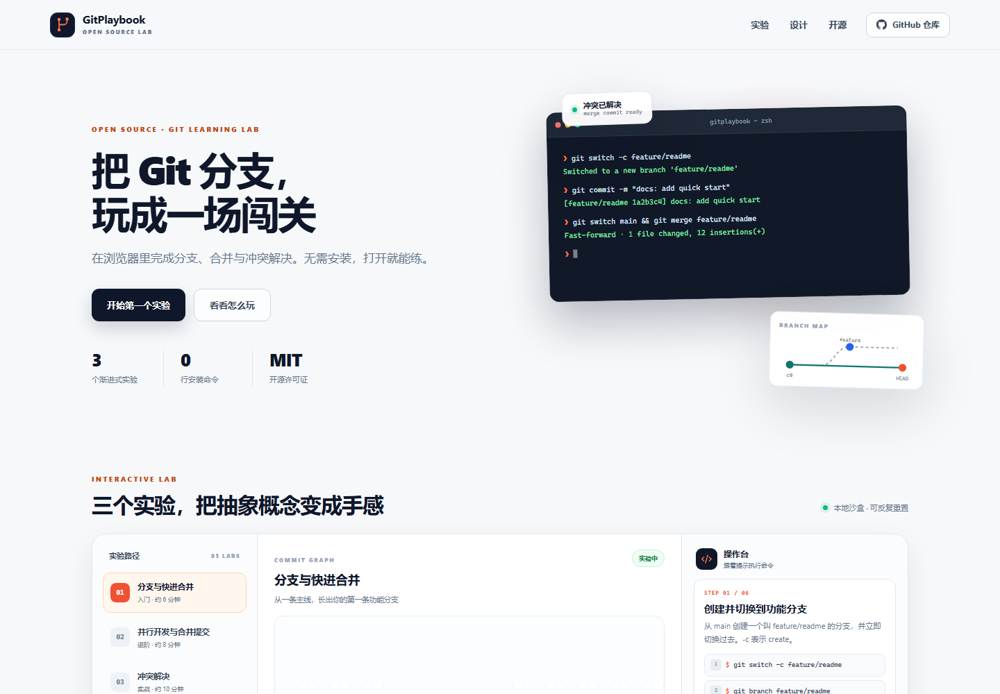

# GitPlaybook

> 把 Git 分支、合并与冲突解决，变成三个可以反复练习的浏览器实验。

[](tests)
[](LICENSE)
[](package.json)
[](CONTRIBUTING.md)

GitPlaybook 是一个面向开源新人的互动教学项目。它不要求你安装 Git、注册账号或连接远程仓库——打开网页，就能在可视化提交图上执行命令、制造一次冲突，然后亲手解决它。

项目本身也按照开源协作的方式开发和维护：有公开的课程脚本、许可证、贡献指南、Issue 模板、Pull Request 模板和持续集成。



## 为什么做这个项目

很多 Git 入门材料能讲清楚 `git branch` 的定义，却很难让人建立“分支只是一个指向提交的指针”的直觉；冲突解决更是常常被一句“手动合并”带过。学习者真正需要的，是一个可以犯错、可以重来、可以看见每一步结果的沙盒。

GitPlaybook 把这三个高频场景拆成渐进式实验：

| 实验 | 你会经历什么 | 对应能力 |
| --- | --- | --- |
| 01 分支与快进合并 | 创建 `feature/readme`、提交、切回 `main`、完成 Fast-forward | 分支创建与合并 |
| 02 并行开发与合并提交 | 两条功能线同时前进，再合并成一条历史 | 并行协作与 merge commit |
| 03 冲突解决 | 两边修改同一行，比较两版内容并完成合并提交 | 冲突定位与解决 |

## 快速开始

项目是纯静态站点，不需要构建，也没有运行时依赖。

```bash
git clone https://github.com/<your-github-username>/GitPlaybook.git
cd GitPlaybook
python -m http.server 4173
```

打开 <http://localhost:4173>。

也可以直接双击 `index.html`。项目使用传统脚本而非 ES Module，因此在 `file://` 协议下同样可以运行。

### 运行测试

```bash
node --test tests
```

## 功能

- **可视化提交图**：每次命令都会生成新的状态快照，分支标签、HEAD 和合并边实时移动。
- **命令级反馈**：选错命令会给出针对当前学习目标的提示，而不是简单报错。
- **冲突对照面板**：并排展示 `HEAD` 与 `feature/header` 的两版内容，支持“保留双方”等解决策略。
- **进度保存**：完成的实验记录在 `localStorage`，刷新页面不会丢失。
- **键盘操作**：按 `1`–`3` 直接执行对应命令。
- **专注模式**：`?view=lab` 隐藏首页，适合课堂投屏；`?lesson=conflict` 可直接进入冲突实验。
- **可访问性**：语义化结构、可见焦点、跳过导航链接，并尊重 `prefers-reduced-motion`。
- **零依赖**：没有框架、没有打包器，便于课堂二次开发。

## 项目结构

```text
gitplaybook/
├─ index.html                 # 单页入口
├─ assets/
│  ├─ css/styles.css          # 设计令牌与响应式布局
│  ├─ img/logo.svg
│  └─ js/
│     ├─ lessons.js           # 三个实验的课程脚本与状态快照
│     ├─ lab-engine.js        # 纯函数状态机（可在 Node 中测试）
│     └─ app.js               # DOM 渲染、键盘交互、进度存储
├─ src/data/site.js           # 首页文案（也是冲突实验的素材）
├─ tests/lab-engine.test.js   # 状态机单元测试
├─ docs/                      # 设计、教学、分支与社区文档
├─ .github/                   # Issue / PR 模板与 CI
├─ CONTRIBUTING.md
├─ CODE_OF_CONDUCT.md
├─ SECURITY.md
└─ LICENSE
```

## 文档

| 文档 | 内容 |
| --- | --- |
| [设计说明](docs/design.md) | 状态模型、提交图布局、交互取舍与测试策略 |
| [教学设计与课程脚本](docs/teaching-design.md) | 学习者画像、认知阶梯、反馈设计与课堂用法 |
| [分支管理与协作流程](docs/branching.md) | 分支模型、合并策略与一次真实冲突的解决记录 |
| [社区运营与互动指南](docs/community.md) | Issue 规范、响应节奏与邀请同学参与的步骤 |
| [路线图](docs/roadmap.md) | 从 v0.1 到 v1.0 的里程碑 |
| [发布清单](docs/publish-checklist.md) | 推送到 GitHub、开启 Pages、收集截图的检查表 |

## 设计取舍

### 为什么是“状态快照”，不是完整 Git 实现

在浏览器里复刻 Git 的对象模型、索引和工作区，成本远高于课程需要。GitPlaybook 把每个学习步骤编码为“命令 + 下一帧状态”，状态机只负责校验命令、推进步骤和记录输出。这样课程作者可以精确控制教学节奏，测试也可以完全脱离 DOM 运行。

这个取舍的边界很清楚：GitPlaybook 是教学模拟器，不是 Git 客户端。它不执行真实文件操作，也不替代在真实仓库中的练习。

### 为什么没有前端框架

页面只有三个主要区域和少量状态，原生 DOM 足够。零依赖让项目可以在任意机房电脑上运行，也降低了贡献者理解代码的门槛。

## 分支模型

项目采用短生命周期的功能分支：

```text
main
 ├─ feature/parallel-lab   新实验：并行开发
 ├─ feature/community-docs 社区文档与贡献指南
 └─ fix/<issue-id>         缺陷修复
```

约定：

- 分支名使用 `feature/`、`fix/`、`docs/` 前缀。
- 提交信息遵循 Conventional Commits，例如 `feat: add conflict lab`。
- 合并前必须通过 `node --test tests`，并至少获得一位维护者的 review。
- 合并方式优先使用 Squash merge；需要保留并行历史的教学内容使用 Merge commit。

更完整的流程见 [docs/branching.md](docs/branching.md)。

## 路线图

- [x] v0.1：三个实验、提交图、冲突对照、进度保存
- [ ] v0.2：实验结果分享链接（把当前提交图编码进 URL）
- [ ] v0.3：教师模式（自定义课程脚本、导出课堂练习）
- [ ] v1.0：接入真实 Git 仓库的只读提交图

## 参与贡献

欢迎提交 Issue 和 Pull Request。适合第一次参与开源的任务会标记为 [`good first issue`](https://github.com/<your-github-username>/GitPlaybook/labels/good%20first%20issue)。

- 提交缺陷前，请先搜索现有 Issue。
- 新功能请先开 Issue 对齐目标，避免大改动返工。
- 提交 PR 前运行测试，并按模板填写变更说明与验证步骤。
- 参与讨论即表示同意遵守 [CODE_OF_CONDUCT.md](CODE_OF_CONDUCT.md)。

## 许可证

代码与文档采用 [MIT License](LICENSE)。你可以自由使用、修改、分发，包括用于商业课程；保留版权声明即可。

## 致谢

- 课程《开源文化运动》对开源治理、许可证与社区协作的讨论，构成了本项目的选题背景。
- 提交图交互受到 Learn Git Branching 等优秀教学项目的启发。
- 所有把第一次 Issue、第一次 PR 留在这里的贡献者。
